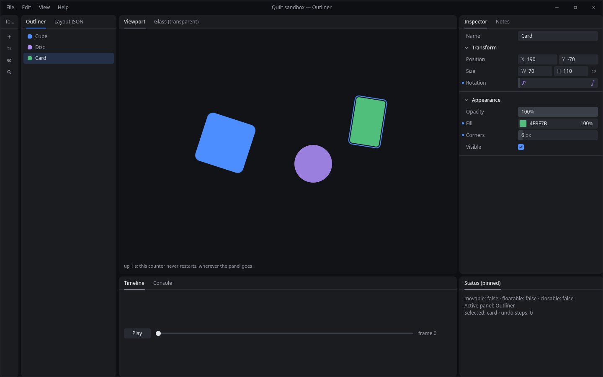
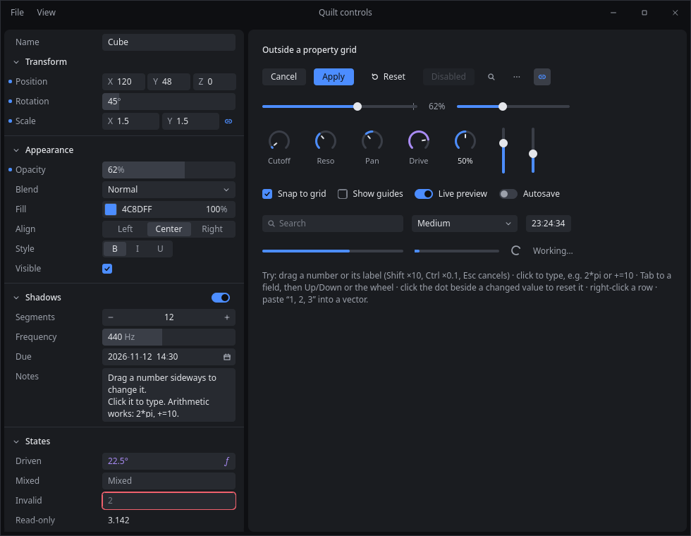

# Quilt

Quilt is a UI kit for panel-based tool applications built with Qt Quick: editors, DCC tools, IDE-like apps, anything made of inspectors, outliners, viewports and timelines. It solves the two problems such an app has that have nothing to do with what it edits:

- **Where the panels go.** Every panel can be resized, rearranged, tabbed, maximized, and popped out into its own window. Each pop-out window is a full docking area, so one application can spread across several monitors.
- **How the user changes a value.** Number fields you can drag, type arithmetic into, or step; vectors, colours, dates, dropdowns, toggles; and a property grid that keeps thirty values readable at a glance. Every control follows one interaction grammar, can be undone in one step, and shows whether a value is modified, driven by an expression, mixed across a selection, or invalid.

Quilt never owns your data. Controls show what your application holds and hand every edit back to it.



Quilt is pure QML: copy one folder and import what you need.

```qml
import QtQuick
import Quilt
import Quilt.Controls

ApplicationWindow {
    width: 1200; height: 760; visible: true

    QtObject { id: box; property real size: 160; property color fill: "#4c8dff" }

    DockArea {
        anchors.fill: parent

        DockPanel {
            panelId: "viewport"; title: "Viewport"
            Rectangle { anchors.centerIn: parent; width: box.size; height: box.size; color: box.fill }
        }
        DockPanel {
            panelId: "inspector"; title: "Inspector"; area: Dock.Right
            Inspector {
                anchors.fill: parent
                PropertyRow { label: "Size"; NumberField { value: box.size; from: 10; to: 400; suffix: " px"; onEdited: v => box.size = v } }
                PropertyRow { label: "Fill"; ColorField { value: box.fill; onEdited: c => box.fill = c } }
            }
        }
        DockPanel { panelId: "timeline"; title: "Timeline"; area: Dock.Bottom }
    }
}
```

## What's in it

| Module | What it gives you |
|---|---|
| `Quilt` | Docking: panels that split, tab, resize, maximize, pop out into windows, and save their arrangement |
| `Quilt.Controls` | Value controls, the property grid (`Inspector`, `Section`, `PropertyRow`), a themed `ApplicationWindow` and a `TitleBar` with menus and window buttons |
| `Quilt.Style` | The theme: dark and light token sets, icons, menus, tooltips. Docking and controls both read it |
| `Quilt.Params` | Optional. A small parameter engine with expressions (`=cube.width / 2`), dependency tracking, cycle detection, save/restore for undo, and merged parameters for multiple selection |

Each layer works without the others: docking with your own controls, or the controls with no docking at all.

### Docking

- **Rearrange by dragging tabs.** Drop a tab on any edge of another panel to split it, in the middle to add it as a tab, between tabs to reorder, or on the edge markers to dock along a whole side of the window. A live preview shows where it will land.
- **Pop-out windows** that accept docked panels exactly like the main window, close themselves when emptied, and send their panels home when closed.
- **State is never lost.** A panel is created once and only re-parented as it moves: text being edited, scroll positions, animations and GPU views survive every move.
- **Split lines that behave like lines.** Dragging a gap moves the whole straight line, across every panel it borders. Ctrl-drag moves one segment; segments snap back into line. Minimum and maximum sizes are honoured.
- **Save and restore** the whole arrangement, pop-outs included, as readable JSON. Autosave is one property.
- **Per-panel restrictions:** `movable`, `floatable`, `closable`, `tabbable`, and size limits.
- **Quiet chrome.** One surface per panel, text-only tabs with an underline, and panel buttons that appear on hover.
- **Works on Wayland, X11, Windows and macOS.**

### Controls

- **One grammar for every control.** Drag a number sideways (Shift ×10, Ctrl ×0.1), click to type, Up/Down to step, Esc to cancel, Enter to commit. The wheel only acts on a focused control, so scrolling past a field never changes it.
- **Forgiving input.** `2*pi`, `(a+b)/2`, `+=10`, `5cm`, `1,5`, pasted lists such as `1, 2, 3`. Text that can't be read stays in the field with the reason, instead of being thrown away.
- **The app owns the value.** Each control re-reads your value after every edit, so a clamped, rounded or refused edit shows what really happened.
- **Edits are transactions.** `editStarted`, `edited`, `editFinished(committed)` on every control: a whole drag is one undo step.
- **Visible state.** Modified (a dot that resets it), driven (`ƒ`), mixed, invalid, read-only. Each has a colour and a shape.
- **A property grid** with one value column, a resizable label column, collapsible sections that remember their state, a row menu (reset, copy, paste, link), filtering, and narrow-panel restacking.
- **A generated inspector.** Give it a list of parameter objects (QML, C++, a `ListModel` or an item model) and it builds the rows, reusing them when the selection changes.
- **The set:** `NumberField` (also the inspector's slider and stepper), `TextField`, `TextArea`, `CheckBox`, `Switch`, `SegmentedButton`, `ComboBox`, `Slider`, `VectorField`, `ColorField` with a picker, `Knob`, `DateField`, `Button`, `IconButton`, `Menu`, `ToolTip`, `ScrollBar`, `ProgressBar`, `BusyIndicator`.
- **Dark and light themes**, high-contrast outlines, no-motion mode, keyboard operation, and accessible names and states.



## Try it

You need Qt 6.8 or newer (developed against 6.12). From the repository root:

```sh
qml6 -I . examples/minimal.qml      # four panels and a small inspector
qml6 -I . examples/gallery.qml      # every control, in every state
qml6 -I . examples/sandbox.qml      # a small editor: docking, linked values, multi-selection, undo
qml6 -I . examples/try-theme.qml    # the gallery under a theme you edit
./run-tests.sh                      # lint + the headless test suite
```

The `qml` runtime may be called `qml6` or `qml`, or it may only exist in Qt's bin directory (`qmake6 -query QT_INSTALL_BINS`). [docs/testing.md](docs/testing.md) covers this. `examples/cpp-host/` is a CMake + C++ application that compiles Quilt in and edits a C++ object.

## Documentation

| Document | What it covers |
|---|---|
| [Docking guide](docs/integration.md) | Adding Quilt to your app; panels, layouts, restrictions, persistence, pop-out windows, styling; docking API reference |
| [Controls guide](docs/controls-guide.md) | Controls, the property grid, undo, parameter states and objects, the generated inspector, `Quilt.Params`, the title bar, theming; controls API reference |
| [Architecture](docs/architecture.md) | How it works: the layout tree, re-parenting, drag and drop, windows, persistence, the value plumbing, the parameter engine |
| [Trying themes and layouts](docs/try-themes-and-layouts.md) | What to run, click and edit to see Quilt in another look or another panel layout; writing a theme and its painters |
| [Testing](docs/testing.md) | Running the QML directly, the automated tests, headless screenshots, the manual checklist |
| [Scope](docs/scope.md) | What Quilt is, what it will never be, and the contracts between controls and your app |
| [Controls design](docs/controls.md) | The interaction grammar and how each control behaves, and why |
| [Visual design](docs/visual-design.md) | The look: rules, tokens, contrast figures |

## Repository layout

```
Quilt/                the modules: copy this folder into your project
  DockArea.qml          docking: a docking surface (one per window)
  DockPanel.qml         docking: a panel; its children are the content
  DockStyle.qml         docking: colours and metrics, defaulting to the theme
  DockWindow.qml        docking: the pop-out window (customisable)
  Dock.qml              docking: enums (Dock.Left, Dock.ReturnPanels, ...)
  DockManager.qml, DockStack.qml, SplitHandles.qml, LayoutTree.js   docking internals
  Style/                Quilt.Style: Theme, Icon, Menu, ToolTip, ...
  Controls/             Quilt.Controls: the controls, the property grid, the title bar
  Params/               Quilt.Params: Parameter, ParameterSet, MergedParameter
  CMakeLists.txt        optional: build the modules into your binary
examples/             minimal.qml, gallery.qml, sandbox.qml, try-theme.qml, cpp-host/ (CMake + C++ app)
tests/                QtQuick.Test suites (run headless)
docs/                 the documentation above
run-tests.sh          lint + tests
```
