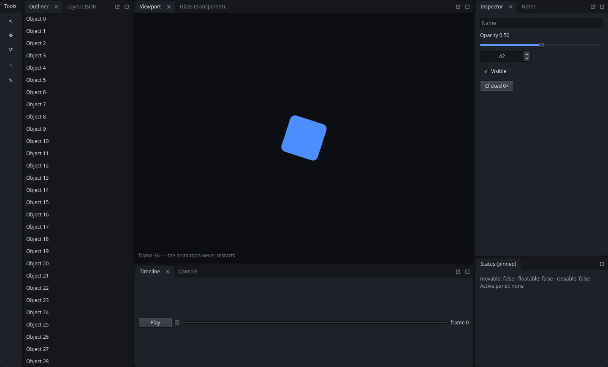
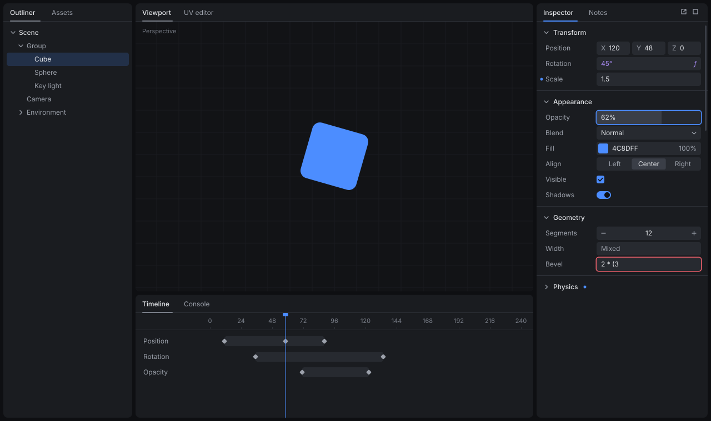

# Visual design plan

This is the plan for how Quilt's panels and controls should look. Nothing here is implemented yet. It covers what is wrong with the look today, the direction to take, the tokens that define it, and the order to apply them in.

For what the controls *do*, see [controls.md](controls.md). For what is in the project, see [scope.md](scope.md).

- [The look today](#the-look-today)
- [The direction: quiet chrome](#the-direction-quiet-chrome)
- [Eight rules](#eight-rules)
- [Tokens](#tokens)
- [Panel chrome: what changes](#panel-chrome-what-changes)
- [How controls look in each state](#how-controls-look-in-each-state)
- [Applying it, in order](#applying-it-in-order)
- [Checking the result](#checking-the-result)
- [Open questions](#open-questions)

## The look today

*`examples/sandbox.qml`, rendered headlessly on Qt 6.12.*

What makes it read as rough and cluttered, with the evidence:

1. **Three dark bands at the top of every panel.** The gap, the tab bar and the panel are three different darks stacked on each other (`#111317`, `#16181c`, `#1e2127`). The tab bar differs from the gap by a contrast of only 1.05:1 and from the panel by 1.10:1. That is too little to read as structure and too much to read as one surface. The eye sees smudges.
2. **Boxes inside boxes.** Each tab group is a rounded box, the current tab is another rounded shape inside it, and the content is a third. Six groups make 24 rounded corners, each notched by a 4 px gap.
3. **Chrome that is always on.** The six tab groups show 13 small glyphs at rest: a close button on each current tab, plus pop-out and maximize on each group. These are rare actions, and they sit at the same visual weight as the panel titles.
4. **No rule for what is bright.** Tab titles, list rows, labels and values are all the same near-white. Nothing tells the eye where the content is.
5. **Two design languages.** The panels are flat and modern. The controls inside them are Qt's stock style: a bevelled button, a square slider handle, a spin box with arrows. They have different heights, borders and corner shapes from each other and from the chrome.
6. **No grid.** Paddings of 6, 8, 10 and 12 px appear with no system. In the inspector, labels sit above some controls and beside others, and no two controls share a left edge.
7. **One text style.** Everything is 12 px in one weight, so hierarchy has to come from colour alone, and colour isn't used for it either (point 4).

Legibility isn't the problem. Dim tab text measures 4.8:1 on the tab bar, which is fine. The problems are structure and noise.

## The direction: quiet chrome

*A static drawing, not a screenshot. It is generated by [`img/look-proposed.py`](img/look-proposed.py) from the token values below. The inspector shows one control in each state: driven (Rotation), modified (Scale), focused (Opacity), mixed (Width) and invalid (Bevel).*

The idea in one sentence: **the interface is the quietest thing on screen, and the user's content and values are the brightest.**

A tool app is looked at for hours. Its frame should disappear the way a good picture frame does. Every decision below removes something from the chrome (a colour, a border, a glyph, a box) until what is left is the user's work, clearly organised.

## Eight rules

1. **One surface per panel.** The tab strip and the content share one colour. A panel is one object, not a header box on a body box.
2. **Space first, a hairline second, a box never.** Group things by putting them close together. Where that isn't enough, use one 1 px line. Don't draw a rectangle around a group.
3. **Values are brighter than labels.** Labels are learned once and then found by position. Values are what the user came to read and change. So values get the primary text colour and labels the secondary one.
4. **A fill means "you can edit this".** Fields are flat fills with no border at rest. Read-only values have no fill. There are no gradients and no bevels.
5. **The accent colour means "yours".** It marks the user's focus, selection and choices: the active panel, the focused field, a checked box, a modified value. It is never decoration. One accent, used sparingly, is what lets it be noticed.
6. **State has its own colours, and each also has a shape.** Driven is violet with an `ƒ`. Invalid is red with a ring. Nothing depends on telling two hues apart.
7. **Chrome appears when it is needed.** Rare actions show on hover. Each one keeps a second path that doesn't need hover: a menu item, a key or a double-click.
8. **Nothing moves unless the movement explains something.** Motion is short and plain. A press has no animation at all.

## Tokens

Every value below becomes a named token in `Quilt.Style`. Docking and controls both read them. An app restyles Quilt by overriding tokens, never by editing components.

### Colour

Dark is the first theme. The neutrals keep the faint cool tint the current palette already has.

| Token | Dark | Used for |
|---|---|---|
| `canvas` | `#0e0f12` | Behind the panels, visible in the gaps |
| `surface` | `#1a1c20` | A panel, including its tab strip |
| `raised` | `#23262b` | Popups, menus, tooltips |
| `control` | `#272a30` | The fill of a field or button at rest |
| `controlHover` | `#2f3239` | The same, hovered |
| `controlFill` | `#3a3e47` | The filled part of a ranged field; the selected segment; scroll bar thumb |
| `border` | `#2d3037` | Hairlines; the edge of a popup |
| `text` | `#e4e6ea` | Values, current tab, section titles |
| `textSecondary` | `#9ca1ab` | Labels, other tabs, glyphs, `Mixed` |
| `textTertiary` | `#787d87` | Placeholders, disabled text, captions |
| `accent` | `#4c8dff` | Focus ring, selection, checked, modified dot, active-tab underline |
| `accentInk` | `#0e0f12` | A glyph drawn on the accent (the check mark, the switch thumb) |
| `driven` | `#a98bf5` | A value computed by something else |
| `error` | `#f0616d` | Invalid input |
| `warning` | `#e0a53a` | Reserved for app use |
| `selection` | accent at 18% | A selected row; selected text is accent at 35% |

Measured contrast (WCAG ratio). Text needs 4.5:1; marks and tertiary text need 3:1.

| | on `surface` | on `control` |
|---|---|---|
| `text` | 13.7 | 11.5 |
| `textSecondary` | 6.6 | 5.5 |
| `textTertiary` | 4.1 | 3.5 |
| `accent` | 5.3 | 4.5 |
| `driven` | 6.3 | 5.3 |
| `error` | 5.4 | 4.5 |
| `accentInk` on `accent` | 6.0 | |

Three things to know about these choices:

- **Dark ink on the accent, not white.** White on `#4c8dff` is only 3.2:1. The dark ink is 6.0:1.
- **Field fills are deliberately faint.** `control` on `surface` is 1.2:1. The field is found by the text inside it and by the column it sits in, as in most current design tools. This is a trade of contrast for calm. A high-contrast token set adds a 1 px outline to every control for users who need it.
- **Small toggles are the exception to "no borders".** An unchecked checkbox is 14 px. A fill that faint would vanish at that size, so it gets a 1.5 px outline in `textTertiary`.

**Light theme.** The same roles, with these starting values. They pass the same contrast checks but have not been judged by eye yet.

| Token | Light | | Token | Light |
|---|---|---|---|---|
| `canvas` | `#e4e6ea` | | `text` | `#1b1d21` |
| `surface` | `#fafafb` | | `textSecondary` | `#565c66` |
| `raised` | `#ffffff` | | `textTertiary` | `#7b818b` |
| `control` | `#eceef1` | | `accent` | `#2a66dd` |
| `controlHover` | `#e2e5e9` | | `accentInk` | `#ffffff` |
| `controlFill` | `#d2d6dc` | | `driven` | `#6f4ad3` |
| `border` | `#dadde2` | | `error` | `#c92f3a` |

### Type

| Token | Value | Used for |
|---|---|---|
| Family | The platform's interface font | Everything. No font is bundled |
| `fontSize` | 12 px | Labels, values, tabs, menus |
| `fontSizeSmall` | 11 px | Captions, ruler numbers, shortcut hints |
| Regular (400) | | Labels and values |
| Medium (500) | | Section titles, the current tab |

- Two sizes and two weights, and no more. No bold, no italics, no capitals for emphasis.
- Sentence case everywhere: "Cast shadows", not "CAST SHADOWS" or "Cast Shadows".
- **Tabular numerals** for every number, so digits don't shift while a value is dragged. Qt supports this through `font.features` (checked on 6.12; available since 6.6).
- Hierarchy comes from the three text colours and the two weights. Size is not used for hierarchy inside a panel.

### Space and size

Everything sits on a 4 px unit. The allowed steps are 2, 4, 6, 8, 12, 16 and 24.

| Token | Value | |
|---|---|---|
| `controlHeight` | 24 | Every field, button, dropdown and segmented button |
| `rowHeight` | 28 | A property row: the control plus 4 px of air |
| `tabHeight` | 32 | The tab strip (today 30) |
| `gap` | 6 | Between panels (today 4) |
| `panelPadding` | 12 | Between a panel's edge and its content |
| `gutter` | 16 | The left margin of a row, which holds the modified dot |
| `controlPadding` | 8 | Between a field's edge and its text |
| `glyphSize` | 12 | Icons, in a 16 px box |

A 30-row inspector with four sections is about 1,000 px tall. One density is enough to start. A `scale` token multiplies text and sizes together for users who want a larger interface.

### Shape

| Token | Value | |
|---|---|---|
| `radius` | 8 | Panels and popups (today 6) |
| `controlRadius` | 4 | Fields, buttons, the selection highlight |
| `innerRadius` | 3 | Things inside a control: a segment, a swatch, a checkbox |
| Pills | half the height | The switch, the scroll bar thumb |
| Hairline | 1 px, `border` | Under the tab strip; between sections |
| Focus ring | 1.5 px, `accent` | Just outside the control's edge |

A shape nested in another always has the smaller radius. Equal radii at different sizes look like a mistake.

### Elevation

There are no shadows.

- Panels are flat. The gap separates them.
- Things that float (menus, dropdown lists, the colour picker, tooltips) use the `raised` colour and a 1 px `border`. In a dark theme a lighter surface already reads as closer, and a shadow on a dark background is nearly invisible anyway.
- This is also the cheap choice: no shader effects, and popups that are real windows need no transparent margin to hold a shadow.

The light theme may need a soft shadow under popups. That is decided when the light theme is.

### Motion

| Token | Value | Used for |
|---|---|---|
| `durationFast` | 80 ms | Hover fading out, a check mark |
| `duration` | 120 ms | A switch, a chevron, a popup appearing |
| `durationLayout` | 160 ms | Panels moving (today's `animationDuration`) |
| Easing | Ease-out cubic | Everything |

- Pressing, dragging and typing are never animated. They respond in the same frame.
- No bounce, no overshoot, no staggered entrances.
- Setting the durations to 0 switches all motion off.

## Panel chrome: what changes

| Element | Today | Proposed | Why |
|---|---|---|---|
| Tab strip background | Its own colour, darker than the panel | The panel's colour, with a hairline beneath | Rule 1: removes a band and a box |
| Current tab | A filled, rounded shape | Text only, in the primary colour and medium weight, with a 2 px underline | Rule 2. The underline replaces the shape |
| Which panel is active | A 2 px accent line over the tab, only after a click | The same underline, turned accent. Other panels' underlines are neutral | One mark does two jobs: which tab, and which panel |
| Other tabs | Dim text; a filled shape on hover | Secondary text, brightening to primary on hover | No shapes appearing and disappearing |
| Close button | On the current tab and on hover | On the hovered tab only | Rule 7. Middle-click and the tab menu still close |
| Pop-out and maximize | Always shown, on every group | Shown while the pointer is over that group's tab strip | Rule 7. Double-click and the tab menu still work |
| Title bar of an untabbable panel | Plain text | Secondary text, no underline | There is nothing to select |
| Gap | 4 px | 6 px | A little more air. Each panel reads as an object |
| Corner radius | 6 px | 8 px | Softer, in step with the wider gap |
| Split-line highlight | A 2 px accent line in the gap | Unchanged | It already follows the rules |
| Drop preview | Accent fill at 22% | Accent at 16%, with a 1 px accent outline | Clearer edge, less wash over the content |

In the sandbox, glyphs at rest go from 13 to 0, and surface colours in the chrome go from four to two.

**How this maps to `DockStyle`.** Existing overrides keep working.

- `background` takes its default from `canvas`, `panel` from `surface`, `text` and `accent` from their namesakes, `textDim` from `textSecondary`.
- `tabBar` defaults to the panel colour. An app that sets it still gets a distinct tab bar.
- One new property chooses whether the group buttons show always or on hover.

**Two presets from the same tokens.**

| Preset | Settings | Feels like |
|---|---|---|
| **Cards** (default) | `gap: 6`, `radius: 8` | Panels as separate objects on a dark canvas. Roomier, current |
| **Seamless** | `gap: 1`, `radius: 0`, canvas set to the `border` colour | Panels divided by hairlines. Densest; suits small screens |

## How controls look in each state

| Control | At rest | Hovered | Active | Notes |
|---|---|---|---|---|
| Field (number, text, dropdown) | `control` fill, no border | `controlHover` | Focus ring while focused or editing | Value in `text`; suffix in `textSecondary` |
| Ranged number field | As a field, with the filled part in `controlFill` | The filled part lightens | The filled part takes an accent tint while dragging | Neutral at rest: twenty blue bars in one inspector would be a wall of accent |
| Stepper buttons | `−` and `+` glyphs in `textSecondary` | Glyph in `text`, on a `controlHover` patch | | |
| Checkbox | 14 px, outlined in `textTertiary` | Outline in `textSecondary` | Checked: `accent` fill with an `accentInk` tick | Mixed: `accent` fill with a dash |
| Switch | 26 × 14 px `controlFill` track, `textSecondary` thumb | Track lightens | On: `accent` track, `accentInk` thumb at the right | |
| Segmented button | `control` track, labels in `textSecondary` | Hovered label in `text` | Selected: a `controlFill` segment with its label in `text` | The selection is neutral. It is a value, not a focus |
| Classic slider | 4 px `controlFill` track, 12 px `text` thumb | Thumb grows to 14 px | Filled part in `accent` | |
| Section header | Chevron in `textSecondary`, title in `text` medium | A faint row tint | | A hairline separates sections |
| Property row | Label in `textSecondary` | A faint row tint | | |
| Button | `control` fill | `controlHover` | Pressed: `controlFill`, at once | Primary: `accent` fill with `accentInk` text |
| Menu, dropdown list | `raised`, 1 px `border`, 8 px radius | Row in `controlHover` | The current option has a tick | |
| Tooltip | `raised`, 1 px `border`, small text | | | |
| Scroll bar | Hidden | A 3 px `controlFill` thumb, 6 px when the pointer is on it | | Overlays the content |
| Progress bar | 4 px `controlFill` track with an `accent` fill | | | |
| Busy indicator | A 16 px arc in `textSecondary` | | | Accent only if it is the main thing on screen |

States from [controls.md](controls.md#parameter-states):

| State | Mark |
|---|---|
| Modified | A 5 px `accent` dot in the gutter |
| Driven | Value in `driven`, with an `ƒ` at the field's right edge |
| Mixed | `Mixed` in `textSecondary` |
| Invalid | A 1.5 px `error` ring |
| Read-only | Value with no fill |
| Disabled | The row at 40% opacity |

## Applying it, in order

Each step is small and leaves the project working. Steps 1 to 3 need no new controls and can be done first.

1. **Add the tokens.** Create `Quilt.Style` with the dark values, and point `DockStyle`'s defaults at it. Nothing changes on screen except the colours.
2. **Restyle the tab strip** in `DockStack.qml`: one surface, text tabs with the underline, a hairline, buttons on hover. This is where most of the visible improvement comes from.
3. **Retune the metrics:** gap 6, radius 8, tab height 32. Check the tests that assume today's values.
4. **Replace the sandbox's controls** as each Quilt control lands (milestones 1 to 3 in [scope.md](scope.md#milestones)). The hand-written `palette { }` block in `sandbox.qml` goes away.
5. **Add the light theme** once the dark one has been checked in real use.

## Checking the result

A look can't be unit-tested, but these checks are quick and repeatable.

| Check | How | Passes when |
|---|---|---|
| Squint | Blur a screenshot heavily, or squint at it | What still stands out is content and values, not chrome |
| Greyscale | Remove the colour from a screenshot | Every state can still be told apart by its shape |
| Glyph count | Count the icons visible with the pointer outside the window | Zero in the dock chrome |
| Contrast | Run the token pairs through a WCAG contrast calculation | The table in [Colour](#colour) holds |
| Alignment | Draw a vertical line down the value column in a screenshot | Every value starts on it |
| Stillness | Hover, focus, modify and invalidate each control | No neighbouring pixel moves |
| Sharpness | Take headless screenshots at 1× and 2× scale (see [testing.md](testing.md#headless-screenshots)) | Hairlines are exactly one device-independent pixel and are not blurred |
| Before and after | Put the new screenshot beside `img/look-current.png` | The new one is plainly calmer |

## Open questions

1. **Text rendering.** At 12 px, Qt Quick's default text rendering can look softer than native text. `Text.NativeRendering` is usually crisper for static interface text. This needs comparing on screen, on each platform, before the type tokens are final.
2. **Hover-only buttons.** Hiding pop-out and maximize until hover is the largest single reduction in clutter, and also the change most likely to be missed by a new user. The tab menu and double-click cover it, and a style property can show the buttons permanently. Worth watching a first-time user.
3. **Glyph style.** The chrome glyphs today are 1.3 px strokes on a 12 px grid. The controls need about a dozen more (chevrons, tick, dash, plus, minus, link, reset). They should be drawn as one set with the same stroke, caps and grid.
4. **The cool tint.** The neutrals lean slightly blue. A fully neutral grey scale is the alternative and suits apps where colour judgement matters (grading, painting). This could be a second token set, not a different design.
